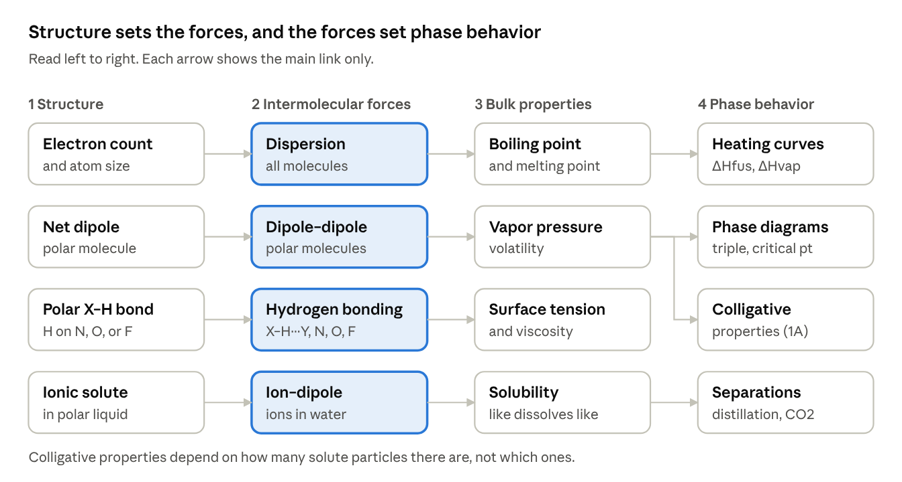
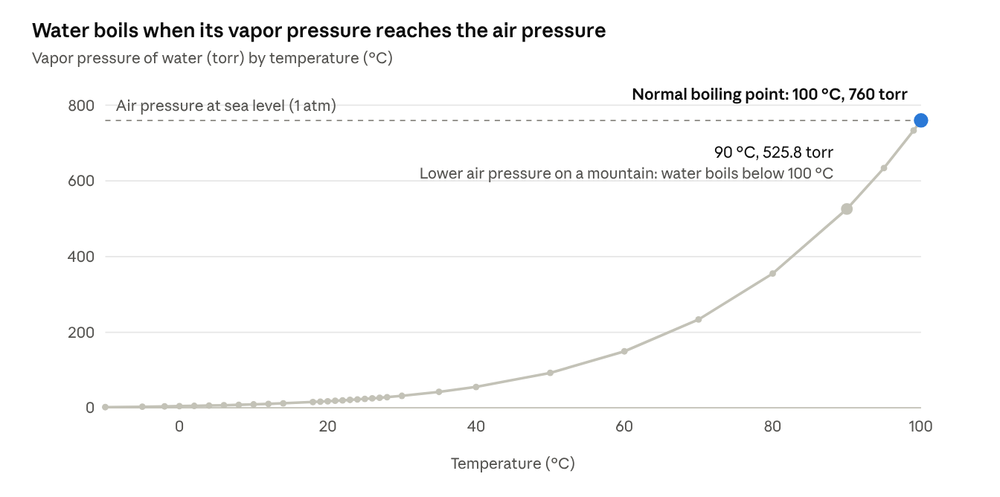

# Sticky Molecules: concept map and build spec

Intermolecular Forces, Phase Changes and Colligative Properties game for CHEM 3A, 1A and 3B.
Dr. Dan (ItsDrDan), Fresno City College. Spec as of Nov 12, 2026.
Live version of this document: https://claude.ai/artifact/MsztkBkxgcFpAw7ueCPGKx (the repo copy is the one to build from).

Art is in `assets/` (see `assets/ART-NOTES.md`). Start from the starter kit in Dr. Dan's `Desktop › Study Games` folder (START-HERE.md, STYLE-GUIDE.md, game-template.html), then follow this file. Where this file and the older STYLE-GUIDE.md disagree, this file wins (for example: default course is 3A here, and the shared brand kit replaces the template's own Canvas resize script).

---

## 1. Purpose and learning goal

Intermolecular forces are the hardest idea in this unit to see. This game makes them visible: molecules stick, attractions break as temperature rises, and the same forces explain boiling points, vapor pressure and why salt lowers the freezing point of water.

Each mode should end with the student saying which force is overcome in a change, and what that costs in energy or in particles.

## 2. Course modes

One game, "Sticky Molecules," with a course picker. Canvas pages pass `?course=3A`, `1A` or `3B`, as the other games do. Opened from the games page, it defaults to **3A**. Modes outside a course stay hidden for that course.

| Topic | CHEM 3A | CHEM 1A | CHEM 3B |
| --- | --- | --- | --- |
| Identify forces in a molecule | Yes | Yes, plus polarizability and shape | Yes, for every organic family: alkanes, alkenes, alcohols, ethers, aldehydes and ketones, carboxylic acids, amines, amides |
| Rank boiling and melting points | Qualitative | Full | Organic series: alkane vs alcohol vs acid; saturated vs unsaturated fats; chain length and branching |
| Vapor pressure, surface tension, viscosity | Recognize only | Full | Not assigned |
| Mixing and solubility | Like dissolves like | Plus ion–dipole | Water solubility vs chain length; hydrophilic and hydrophobic ends |
| Macromolecules preview | Not assigned | Not assigned | Early: DNA base pairs, protein folding, phospholipid bilayer, starch vs cellulose |
| Phase-change names, endo/exo, why plateaus are flat | Yes | Yes | Not assigned |
| Heating-curve calculations | Link to the thermochemistry game | Link to the thermochemistry game | Not assigned |
| Phase diagrams | Simple reading | Full: triple point, critical point, supercritical fluid, slope | Not assigned |
| Tonicity and cells | Yes: isotonic, hypotonic, hypertonic animations, IV fluids, no equations | Yes, with Π = iMRT | Introduced with osmosis and diffusion in the metabolism unit |
| Colligative calculations | Not assigned | Full: Raoult, ΔTb, ΔTf, van't Hoff i, osmotic pressure | Not assigned |

Colligative content is taught in CHEM 1A and also appears on the CHEM 1B final, so it keeps a reduced share in final-review sampling.

**3A textbook scope:** the IMF content is in Chapters 6 and 7 of the 3A book (LibreTexts *Introductory Chemistry, Atoms First for FCC*), mostly Chapter 6.

### 3B examples (from the CHEM 3B Exam #3 Reference Sheet)

Use only molecules on the sheet, so students practice with structures they will see on the exam.

- **Fatty acids:** lauric, myristic, palmitic, stearic (saturated, 12 to 18 carbons); palmitoleic and oleic (one cis double bond); linoleic (two); linolenic (three); arachidonic (four). Pattern: longer chains mean more dispersion force and a higher melting point; each cis double bond adds a kink, so chains pack poorly and the melting point drops. The sim can show straight chains stacking tightly next to kinked chains that can't.
- **Amino acid side chains:** match Peptide Party (`ItsDrDan/aminoacids`) for which residue falls in which group. The rules students apply:
  - an –OH side chain hydrogen bonds;
  - an acidic side chain plus a basic one makes a salt bridge;
  - two cysteines make a disulfide linkage (covalent: a good contrast question);
  - nonpolar side chains make hydrophobic interactions;
  - polar side chains make dipole–dipole interactions;
  - hydrophilic side chains interact with nearby water molecules.
- **Protein folding:** matches what 3B teaches. Secondary structure: hydrogen bonds between backbone C=O and N–H groups hold the α-helix and β-sheet. Tertiary structure: side-chain interactions (hydrophobic, hydrogen bonds, salt bridges, covalent disulfide bridges) fold the chain, with nonpolar side chains tucked inward away from water. Reuse concepts and diagrams from Peptide Party so the two games teach it the same way.
- **Carbohydrates:** every sugar on the sheet carries many –OH groups, so they hydrogen bond and dissolve in water. Fischer projections from the sheet can show where the donors and acceptors are.
- **Macromolecule preview** (no structures needed from the sheet): DNA base pairs held by 2 or 3 hydrogen bonds; the phospholipid bilayer with polar heads out and tails in; starch vs cellulose, where cellulose chains hydrogen bond into strong fibers.

### Shared across modes

- Wrong-answer feedback for every answer choice, tied to a named slip (section 5).
- A numerically correct answer with wrong sig figs gets a yellow "close, but fix your sig figs" notice.
- Teaching tips are labeled "Professor Tip".
- Constants come from the yellow sheet and OpenStax (section 8).

## 3. Concept map

Structure sets which forces a molecule has. Forces set bulk properties, and those set phase behavior. Colligative properties (1A) hang off vapor pressure, because solute particles lower it.

| 1 Structure | 2 Intermolecular force | 3 Bulk property | 4 Phase behavior |
| --- | --- | --- | --- |
| Electron count and atom size | Dispersion (all molecules) | Boiling and melting point | Heating curves (ΔHfus, ΔHvap) |
| Net dipole (polar molecule) | Dipole–dipole (polar molecules) | Vapor pressure (volatility) | Phase diagrams; colligative properties (1A) |
| Polar X–H bond (H on N, O or F) | Hydrogen bonding (X–H···Y) | Surface tension and viscosity | |
| Ionic solute in a polar liquid | Ion–dipole (ions in water) | Solubility (like dissolves like) | Separations (distillation, supercritical CO₂) |

Suggested mode order:

1. Force identification (all courses), with the molecule picker.
2. Hydrogen-bond container and energy well.
3. Phase-change view (heating-curve calculations link out to the thermochemistry game).
4. Phase diagram explorer.
5. Raoult's law and vapor pressure (1A).
6. Freezing and boiling point change, van't Hoff factor (1A).
7. Osmosis, tonicity and cells (3A and 1A; 3B in the metabolism unit).

## 4. Question types

Write every question as an original. Use the lecture and worksheet items as models for pattern and difficulty, and never copy a Skill Check item.

| Question type | Course | Model | Pattern |
| --- | --- | --- | --- |
| Name the forces in a molecule | All | Worksheet 12 A1; Lecture 28 slide 40 | Lewis structure in, every force and the strongest one out |
| Pick the higher boiling or melting point | All | Worksheet 12 Q3–4; Lecture 28 slide 56 | Two similar molecules; the answer must name the force |
| Size trap | 3A, 1A | Lecture 28 slide 33 | Don't compare size alone when one molecule has H-bonding |
| Polarizability: more viscous or volatile | 1A | Lecture 28 slides 9–13, 57 | Electron count and shape decide |
| Vapor pressure from evaporation | 1A | Lecture 28 slides 50–53 | Weak forces mean high vapor pressure |
| Surface tension and viscosity ranking | 1A | Worksheet 12 Q5–7 | Octane vs octanol; propanediol isomers |
| Mixing and solubility | 1A, 3B | Lecture 28 slides 36–41 | Matching forces mix; mismatched forces stay apart |
| Phase-change names, endo/exo, plateaus | 3A, 1A | Lecture 28 slides 59, 71–79; Lecture 18 | Name each segment; why the temperature holds |
| Read a phase diagram | 3A simple, 1A full | Lecture 28 slides 60–68; Worksheet 12 Q23–25, Q28 | Name the change when a line is crossed; normal boiling point; triple point |
| Raoult's law and mixtures | 1A | Lecture 4 slides 7–12 | Glycerin in ethanol; pentane and hexane at 258 torr |
| Concentration conversions | 1A | Lecture 4 slides 1–4 | Molarity, molality, mole fraction, mass percent |
| ΔTb and ΔTf | 1A | Lecture 4 slides 13–18; Lecture 5 slide 4 | Ethylene glycol to reach −23.3 °C in 10.0 kg of water |
| van't Hoff factor | 1A | Lecture 5 slides 10–12 | K₃PO₄ gives i = 4 |
| Expected vs observed i | 1A | Lecture 5 slides 14–15 | Fe(NH₄)₂(SO₄)₂ osmotic pressure check |
| Osmosis and tonicity | 3A, 1A, 3B | Lecture 5 slides 6–9 | Red blood cells in hypo- and hypertonic solutions |
| Colloids and emulsifiers | 3B | Lecture 5 slides 18–22 | Tyndall effect; hydrophilic and hydrophobic ends |

Hand-worked sanity checks (verify before they go in an answer key):

- Ethylene glycol: ΔTf ÷ 1.86 ≈ 12.5 mol/kg; for 10.0 kg of water ≈ 125 mol ≈ 7.8 kg of ethylene glycol.
- Glycerin in ethanol: mole fraction of ethanol ≈ 0.83, so pure ethanol ≈ 136 torr at 40 °C.
- Pentane and hexane: mole fraction of pentane ≈ 0.39.
- Methanol (Worksheet 12 Q26): 225 g ÷ 32.04 g/mol × 38.0 kJ/mol ≈ 267 kJ.

Difficulty models, for style only (never copy items):

- **CHEM 3A:** Tro, *Introductory Chemistry* test bank (Desktop › Study Games › CHEM 3A Resources › `tro_intro7_testbank_word.zip`), Chapter 12 "Liquids, Solids, and Intermolecular Forces" (115 items, 94 at difficulty 1) and Chapter 13 "Solutions" (123 items). The zip is named intro7, but the files inside say 6th edition. They are old `.doc` files: convert with `soffice --headless --convert-to txt`.
- **CHEM 1A:** Tro, *Chemistry: A Molecular Approach* 6e test bank, Chapter 12 (151 items) and Chapter 14 (187 items); MyOpenMath CHEM 1A Week 14 team worksheet and Week 17 homework (section 10).

## 5. Misconceptions and named slips

Each slip has a name for stats logging and a feedback line the game shows when a wrong answer matches it. The sims should also make the right idea visible.

| Slip name | What the student believes | Feedback line | What the sim shows |
| --- | --- | --- | --- |
| boil-breaks-bonds | Boiling water splits H₂O, or breaks O–H bonds | Boiling pulls whole molecules apart from each other. The steam is still H₂O. | Molecules never break apart in any sim |
| hbond-is-covalent | A hydrogen bond is a shared-electron bond | It is an attraction between molecules, with no shared electrons, and much weaker than a covalent bond. | Dashed line, never a solid stick |
| any-h-hbonds | Any molecule with H can hydrogen bond (CH₄, HCl, CH₃OCH₃) | The H must be bonded directly to N, O, or F. Dimethyl ether can accept an H-bond from water but has no donor of its own. | Donor H glows only on N–H, O–H, F–H |
| polar-bonds-polar-molecule | Polar bonds always make a polar molecule (CO₂, CCl₄, BF₃) | Symmetric shapes cancel bond dipoles, so the molecule has dispersion forces only. | Bond-dipole arrows sum to zero |
| type-always-wins | Hydrogen bonding always beats dispersion | The ranking holds for molecules of similar size. Octane (no H-bonds) boils above water because it has many more electrons. | Well depth grows with electron count |
| size-ignores-type | The bigger molecule always boils higher | Check the force type first when sizes are similar: ethanol vs dimethyl ether, propylamine vs butane. | Side-by-side wells |
| vp-backwards | Strong forces mean high vapor pressure | Strong forces hold molecules in the liquid, so fewer escape and the vapor pressure is low. | Escape counter |
| plateau-heats-up | Temperature rises while ice melts or water boils | During a phase change the heat breaks attractions instead of speeding molecules up, so the temperature holds. | Thermometer holds still while attractions break |
| endo-exo-swap | Condensing or freezing absorbs heat | Forming attractions releases heat: condensation, freezing and deposition are exothermic. | Heat arrows point out |
| more-pressure-always-liquefies | Enough pressure liquefies any gas | Above the critical temperature, no pressure makes a liquid. | Meniscus vanishes past Tc |
| triple-critical-swap | Triple point and critical point mixed up | Triple point: all three phases coexist. Critical point: liquid and gas merge. | Both points labeled on the explorer |
| molarity-for-molality | Uses molarity for ΔTb or ΔTf | Boiling and freezing point changes use molality: moles per kilogram of solvent. | Units shown on the calculator card |
| forgot-i | Uses i = 1 for an ionic solute | Count the ions: NaCl gives 2, K₃PO₄ gives 4. | Dissolving animation counts particles |
| i-for-molecular | Uses i > 1 for glucose or ethylene glycol | Molecular solutes stay whole, so i = 1. | Molecule stays one particle |
| fp-sign | Adds ΔTf to the freezing point | Freezing points go down: subtract ΔTf. | Thermometer drops |
| raoult-solute-fraction | Uses the solute mole fraction in Raoult's law | Use the solvent's mole fraction. | Surface spots blocked by solute |
| celsius-in-gas-law | Uses °C in Π = iMRT | Temperature must be in kelvin. | Unit check on the answer box |
| tonicity-swap | Thinks water moves toward the lower solute concentration | Water moves toward the higher solute concentration: a hypertonic bath shrinks the cell. | Arrow counts in and out of the cell |
| kj-vs-j | Mixes kJ/mol and J/g | Match the units of ΔH to moles or grams before multiplying. | Unit badge on each value |

Note: octane's boiling point (about 126 °C, above water) is not from Dr. Dan's sources; verify it before it goes in the game.

## 6. Simulations and interactions

Every simulation is labeled on screen as a teaching model with stated simplifications. None is molecular dynamics. Each one opens with a prediction the student makes before the sim runs.

**6.1 Hydrogen-bond container (3A, 1A, 3B).** Eight to twelve molecules in a box, drawn bent with δ+ and δ− labels. A dashed line appears when an H on one molecule points at a lone pair on another, within a set distance and angle. Choose H₂O, NH₃, HF, CH₃OH, or CH₄ (dispersion only). A counter shows H-bonds per molecule. Raising temperature speeds the molecules up, and the dashes flicker and vanish. Prediction: which molecule keeps more bonds at high temperature, and why does that match its boiling point?

**6.2 Phase-change view (3A, 1A).** Heating-curve calculations live in the thermochemistry game (itsdrdan.github.io/thermochemistry), so this mode links there rather than rebuilding them. What stays here is the molecular picture: a simple curve beside a particle box, where each plateau shows attractions breaking while the thermometer holds still. Also phase-change names and endo/exothermic (Week 17 questions 7 and 10e).

**6.3 Energy well (1A, optional 3A).** A potential energy curve for two molecules (Lecture 29 slide 3). A slider sets well depth (IMF strength) and a horizontal line sets kinetic energy. When kinetic energy exceeds the well depth, the molecules separate. Presets run from dispersion (shallow) to ion–dipole (deepest). Relative depths only, no numbers.

**6.4 Phase diagram explorer (3A simple, 1A full).** Axes: pressure (atm) and temperature (°C). Presets: water (negative fusion slope), CO₂ (no liquid at 1 atm), hydrazine from Worksheet 12 Q28 (normal boiling point 113.5 °C; triple point 2.0 °C and 3.4 mm Hg ≈ 0.0045 atm; critical point 380 °C and 145 atm). Drag a state point across a line to see the change. A sealed-tube panel shows the meniscus vanish at the critical point. Check: CO₂ at 1 atm, heated from −100 °C, goes straight from solid to gas.

**6.5 Electron coin-flip (1A).** Electrons flip left or right; a slider sets electron count. The chance of an even split sits next to the boiling points of noble gases and hydrocarbons, which rise with electron count. Use the corrected 36-electron value (section 9).

**6.6 Mixing and solubility (1A, 3B).** Drop a molecule into a water or hexane beaker. Matching forces mix; mismatched forces stay apart. Presets: CH₄, CH₃F, CH₃OH, hexane, NaCl.

**6.7 Raoult's-law mixer (1A).** Two volatile liquids in one chamber, slider for mole fraction. Bars show each partial pressure and the total. Preset: pentane and hexane at 258 torr (study-check numbers).

**6.8 Particle-count freezing point (1A).** Same molality, three solutes: ethylene glycol (i = 1), NaCl (i = 2), K₃PO₄ (i = 4). The drop follows particle count, not identity: at 1 m in water, 1.86, 3.72 and 7.44 °C. Students predict the order first.

**6.9 Tonicity and cells (3A, 1A; 3B in the metabolism unit).** The centerpiece animation. The student predicts which way the water moves before each run.

- **Red blood cell:** a biconcave disc in a bath, with arrows for water crossing the membrane both ways. Isotonic: equal arrows, cell keeps its shape. Hypertonic bath: more arrows out, the cell shrinks and puckers (crenation). Hypotonic bath: more arrows in, the cell swells to a sphere, then bursts (hemolysis), tinting the bath red.
- **Plant cell:** same baths. Hypotonic: turgid (the wall stops it bursting). Hypertonic: the membrane pulls away from the wall (plasmolysis).
- **Presets:** 0.9% NaCl (normal saline, isotonic), pure water (hypotonic), 3% NaCl and seawater (hypertonic; ties to Tro's question on why drinking seawater dehydrates you).
- **3A** sees words and particle counts only. **1A** adds the osmosis chamber with a piston and Π = iMRT, with blood ≈ 7.7 atm (OpenStax 11.4). Check: 0.9% NaCl is 0.154 M with i = 2, giving ≈ 7.8 atm at 37 °C, close to blood.

Every sim needs large touch targets and a phone layout, and uses the shared brand kit.

### Model rules for every sim

1. **One particle model.** 2D molecules with a pair attraction. Each substance gets a well depth (its stickiness) proportional to its ΔHvap, so every ranking matches real data.
2. **Calibration values** (kJ/mol at the boiling point, from Dr. Dan's MyOpenMath data tables): water 40.70, isopropyl alcohol 39.90, ethanol 38.56, diethyl ether 26.50. CCl₄ ≈ 31.8 (from Week 14 Q12: 56.85 kJ for 275.0 g). OpenStax adds benzene 30.8 and acetone 31.3 at their boiling points, and Br₂ 30.9, methanol 38.2, ethanol 42.8 and CCl₄ 32.5 at 25 °C (from Appendix G formation enthalpies). OpenStax has no ΔHvap for methane, the noble gases or the other halogens: for those presets, scale stickiness by normal boiling point in kelvin (Trouton's rule: the two track each other without hydrogen bonding; the game only needs the right order).
3. **Escape rule** (Lecture 28 slide 52): temperature sets a spread of kinetic energies, and a molecule leaves the liquid only when its energy beats the attraction holding it. The vapor pressure readout is the count of escaped molecules.
4. **Plateaus:** during melting and boiling, added heat goes into breaking attractions, and the thermometer readout holds constant.
5. **H-bond rule:** draw a dashed line when an H on N, O, or F sits within about 2.5 Å of a lone pair on N, O, or F and the D–H···A line is close to straight (at least about 135°). The usual geometric test, simplified.
6. **Water preset:** ice is an open hexagonal lattice with 4 H-bonds per molecule. Melting collapses it into the denser liquid, which shows why ice floats.
7. **Strength scale:** relative well depths only, ordered dispersion < dipole–dipole < hydrogen bond < ion–dipole for molecules of similar size, but dispersion grows with electron count. Any number on screen comes from the data table.
8. **Molecules never break apart.** Phase changes only separate whole molecules.
9. **Performance:** at most 60 molecules on a phone and 150 on a desktop, drawn on a canvas, paused when the tab is hidden.
10. **Accessibility:** δ+ and δ− shown as text, not color alone; a reduced-motion setting that steps through frames; a one-line caption describing what is happening.

## 7. Visual library

Drawings to build (source in parentheses):

- **Dispersion:** electron cloud before and after an instantaneous dipole induces one in a neighbor (Lecture 28 slide 6).
- **Dipole–dipole:** an HCl pair with δ+ and δ− attraction (slide 21).
- **Hydrogen bond:** X–H···Y with donor and acceptor labeled, and a four-water network (slides 24–25).
- **Net dipole vs cancellation:** CO₂ against H₂O; CH₂Cl₂ against CCl₄ (slides 18, 34).
- **Force ladder:** weakest to strongest, a relative scale with no numbers (slide 32).
- **Phase diagram:** labeled regions, triple point, critical point, sublimation, supercritical zone (slides 60–67).
- **Sealed-container vapor pressure:** molecules escaping and returning at equilibrium (slide 51).
- **Distillation setup:** flask, condenser, receiver (slide 70).
- **Heating curve:** five labeled segments (slides 73–79).
- **Raoult's law bars:** each partial pressure next to the total (Lecture 4 slides 7–12).
- **Osmosis chamber:** two chambers, membrane, piston (Lecture 5 slide 6).
- **Red blood cells:** crenation and hemolysis against isotonic cells (Lecture 5 slide 9).
- **Dissociation count:** K₃PO₄ splitting into three K⁺ and one PO₄³⁻, so i = 4 (Lecture 5 slide 12).

Charts:

- **Boiling point against molar mass:** noble gases, hydrocarbons and halogens (section 8). The strongest chart for the dispersion argument.
- **Where the 47.2 kJ goes:** a waterfall of the five heating-curve steps from the Lecture 28 worked example (15.0 g ice at −20.0 °C to steam at 145.0 °C).
- **Freezing-point drop at 1 m:** i = 1, 2, 4 give 1.86, 3.72 and 7.44 °C.
- **Electron count against even-split chance:** 2, 10, 18, 36, 54 electrons → 50.0, 24.6, 18.5, 13.2, 10.8 %.
- **Vapor pressure of water vs temperature** (below). Answers the Week 17 question on boiling at high altitude; can be a live readout in the sealed-container sim.

Data (OpenStax Chemistry 2e, Table 9.2), °C : torr —
−10: 1.95, −5: 3.0, −2: 3.9, 0: 4.6, 2: 5.3, 4: 6.1, 6: 7.0, 8: 8.0, 10: 9.2, 12: 10.5, 14: 12.0, 18: 15.5, 19: 16.5, 20: 17.5, 21: 18.7, 22: 19.8, 23: 21.1, 24: 22.4, 25: 23.8, 26: 25.2, 27: 26.7, 28: 28.3, 30: 31.8, 35: 42.2, 40: 55.3, 50: 92.5, 60: 149.4, 70: 233.7, 80: 355.1, 90: 525.8, 95: 633.9, 99: 733.2, 100: 760.0.

## 8. Reference values and sources

OpenStax Chemistry 2e is the authority for any value a game states. Lecture values are cross-checked against it.

| Value | Figure | Source |
| --- | --- | --- |
| Water ΔHfus | 6.02 kJ/mol (334.16 J/g) | Lecture 28 slide 74; MyOpenMath Week 14 |
| Water ΔHvap | 40.70 kJ/mol at the boiling point (2259 J/g); 44.0 kJ/mol at 25 °C | Lecture 28 slide 76; MyOpenMath Week 14 (OpenStax: 40.67) |
| Water specific heat, ice / liquid / steam | 2.06 / 4.184 / 2.02 J/(g·°C) | Lecture 28 slides 73, 75, 77 |
| Water Kf and Kb | 1.86 and 0.512 °C·kg/mol | OpenStax Table 11.2 |
| Osmotic pressure | Π = MRT, with i for electrolytes, T in kelvin | OpenStax 11.4 |
| Blood osmotic pressure | about 7.7 atm (7.6 atm at 37 °C in end-of-chapter problem 61) | OpenStax 11.4 |
| ΔHvap at the boiling point | ethanol 38.56, isopropyl alcohol 39.90, diethyl ether 26.50 kJ/mol | MyOpenMath Week 14 data tables |
| ΔHfus | ethanol 4.90, isopropyl alcohol 5.37, diethyl ether 7.27 kJ/mol | MyOpenMath Week 14 data tables |
| Methanol ΔHvap | 38.0 kJ/mol | Worksheet 12 Q26 |
| Hydrazine phase points | Normal bp 113.5 °C; triple point 2.0 °C and 3.4 mm Hg; critical point 380 °C and 145 atm | Worksheet 12 Q28; Week 14 Q8 |
| Noble gas boiling points | He 4.2, Ne 27, Ar 87, Kr 120, Xe 165 K | Lecture 28 slide 9 |
| Hydrocarbon boiling points | CH₄ 112, C₂H₆ 185, C₃H₈ 231, C₄H₁₀ 274, C₅H₁₂ 309 K | Lecture 28 slide 14 |
| Halogen melting / boiling points | F₂ 53/85, Cl₂ 172/238, Br₂ 266/332, I₂ 387/457, At₂ 575/610 K | OpenStax Table 10.1 |
| Alcohol vapor pressures at 20 °C | methanol 11.9, ethanol 5.95, propanol 2.67, butanol 0.56 kPa | OpenStax Example 10.5 |

Liquid properties at 25 °C (OpenStax Tables 10.2 and 10.3):

| Liquid | Surface tension (mN/m) | Viscosity (mPa·s) |
| --- | --- | --- |
| Water | 71.99 | 0.890 |
| Ethylene glycol | 47.99 | 16.1 |
| Ethanol | 21.97 | 1.074 |
| Octane | 21.14 | 0.508 |
| Mercury | 458.48 | 1.526 |
| Honey | | about 2,000 to 10,000 |
| Motor oil | | about 50 to 500 |

Sources: Lectures 4, 5, 15, 18, 28 (combined, separate, PDF) and 29; Worksheet 12; CHEM 3B Exam #3 Reference Sheet; OpenStax Chemistry 2e Chapters 9–11 and Appendix G; Tro test banks (Intro Chemistry Ch 12–13; Molecular Approach 6e Ch 12, 14); MyOpenMath CHEM 1A Week 14 team worksheet and Week 17 homework.

## 9. Errors and decisions — do not repeat these in the game

1. **Lecture 28 slide 12, 36 electrons:** the slide gives 12.5%. The exact even-split chance is C(36,18) ÷ 2³⁶ ≈ 13.2%. The other values (50.0, 24.6, 18.5, 10.8) are right.
2. **Lecture 28 slide 14 / Lecture 15:** the table header reads "Noble Gases" over hydrocarbon data. Label it hydrocarbons.
3. **CH₄ solubility (slide 38) and "H-bonds are 2% of a covalent bond" (slide 30): dropped.** Keep only the qualitative points: CH₄ barely dissolves in water; hydrogen bonds are much weaker than covalent bonds.
4. **Lecture 28 slide 73:** the heating-curve axis says kJ/mol while Cp is in J/(g·°C). Pick one unit per axis.
5. **Water surface tension:** slide 46 gives 72.8 mJ/m² (the ~20 °C value). Use OpenStax 71.99 mN/m at 25 °C.
6. **Ammonia ΔHvap:** OpenStax 10.3 gives 4.8 kJ/mol, which looks wrong (commonly cited ≈ 23 kJ/mol). Don't use it.
7. **Water ΔHvap:** OpenStax 40.67 vs MyOpenMath 40.70 kJ/mol. Pick one and use it everywhere (40.70 matches his homework).
8. **Worksheet 12 Q28:** convert 3.4 mm Hg to ≈ 0.0045 atm on the diagram.
9. **Week 17 Q8d** ("highest temperature the substance can be a liquid" = 260 °C, the critical point): MyOpenMath wording stays as is, but the game's version must state the pressure is at least 52 atm.

Checked and consistent: the water ΔHfus and ΔHvap values agree between Lecture 18 (kJ/mol) and Lecture 28 (J/g), and the worked 47.2 kJ example adds up.

## 10. Week 17 homework alignment (MyOpenMath, CHEM 1A, Ch. 10 & 11)

| Week 17 question | Game mode | Course |
| --- | --- | --- |
| Strongest force in Ar, BF₃, PH₃, CH₃OH | Force identification | 1A |
| Higher boiling point: NH₃ vs PH₃, propylamine vs butane, CF₄ vs CBr₄, ethanol vs dimethyl ether | Property ranking | 1A, 3A |
| Miscibility: NaCl/hexane, hexane/water, methanol/hexane, pentane/hexane | Mixing and solubility | 1A, 3B |
| Ranking forces; covalent vs intermolecular; H-bond definition; forces in water | Force identification | 1A, 3A |
| Evaporation, dynamic equilibrium, viscosity with heat, boiling at altitude | Vapor pressure and liquid properties | 1A |
| Highest surface tension, lowest boiling point (noble gases), highest vapor pressure | Property ranking | 1A |
| Phase-change names and endo/exothermic | Phase-change view | 1A, 3A |
| Phase diagram: triple, critical, supercritical, sublimation | Phase diagram explorer | 1A |
| Ice at −33 °C to steam at 157 °C, total heat and largest step | Heating curves (link to thermochemistry) | 1A, 3A |
| Condensing 18 g steam and cooling to 22 °C | Heating curves (link to thermochemistry) | 1A |
| KBr in water: moles, molality, i, ΔTf, ΔTb | Colligative | 1A |
| Osmotic pressure of MgCl₂; Raoult's law for glucose | Colligative | 1A |
| Boiling point ranking by solute; ion pairing; vapor pressure direction | Colligative | 1A |

Worked answers (my arithmetic, for patterns only — don't reuse these exact problems):

- Ice to steam, 47.5 g: ≈ 151.7 kJ total; vaporization is the largest step.
- 18 g steam condensed and cooled to 22 °C: ≈ 46.5 kJ released.
- 30.6 g KBr in 600 g water: 0.257 mol, 0.429 m; i = 2 → ΔTf = 1.59 °C, ΔTb = 0.44 °C, bp 100.44 °C.
- 0.135 M MgCl₂ at 37 °C, i = 3: Π ≈ 10.3 atm.
- 80.5 g glucose in 150 g water at 25 °C: X(water) = 0.949, P ≈ 22.6 torr, ΔP ≈ 1.2 torr.

## 11. Build rules

Start from the starter kit (Desktop › Study Games: START-HERE.md, STYLE-GUIDE.md, game-template.html), then check every item.

**Files and repo**

- [ ] One standalone HTML file per revision, version number in the file name only (`sticky-molecules-v1.html`), never in the header or a badge.
- [ ] Repo: `ItsDrDan/IMF`, served as `index.html`. Push to GitHub only when Dr. Dan says to.
- [ ] `meta.json` for the study hub card: topic label "Intermolecular Forces", fun name "Sticky Molecules".
- [ ] Instructor notes go in `INSTRUCTORS.md` (synced to the FCC-Chem/tools catalog as README), never inside the game.
- [ ] All-rights-reserved `LICENSE`, as in the other repos.

**Look and layout**

- [ ] Load the shared brand kit after the game's own styles: `https://itsdrdan.github.io/games/brand/itsdrdan.css`, `.../brand/icons.js` (line-art icons through `ddIcon()`, no emoji in game chrome), then `.../brand/embed.js` (Canvas iframe auto-resize, no inner scrollbar).
- [ ] Pastel look, large controls (≥ 44–48 px), responsive on phone, desktop and inside Canvas; no horizontal scrolling on phones.
- [ ] Instructions at the top kept to a line or two.
- [ ] Header course labels: CHEM 3A • 1A • 3B.
- [ ] XP and achievements below the practice area.
- [ ] Footer AI credit, word for word: "Game design and chemistry by ItsDrDan. I used AI (Claude by Anthropic) to help write the code, the way I hope you'll use it: as a tool, while checking every answer and understanding the chemistry and math behind it."

**Course and questions**

- [ ] Read `?course=3A`, `1A` or `3B` from the address; default to 3A.
- [ ] Feedback on every answer choice, linked to a named slip.
- [ ] Correct number with wrong sig figs: marked correct, with the yellow "close, but fix your sig figs" notice. Sig-fig grading rule as in STYLE-GUIDE.md.
- [ ] Scientific notation accepts E notation; calculator hints written for the TI-36X Pro.
- [ ] "Professor Tip" for teaching tips.
- [ ] Data in small tables or charts, units written like kJ mol⁻¹, constants from the yellow sheet (Avogadro 6.0221 × 10²³).
- [ ] No copied Skill Check or test-bank items; Tro and MyOpenMath used for style only.

**Connections**

- [ ] Export questions to the shared bank (`ItsDrDan/questionbank`) so the Daily 5 can sample them.
- [ ] Log named slips to the anonymous Game Stats sheet, with no names or IDs.
- [ ] Per-game feedback widget (`brand/feedback.js`): 1–5 rating with comments and the professor picker (Dr. Dan, Professor Alex, Professor Gilley, Dr. Dan/Professor Xiong).
- [ ] Link card to the thermochemistry game for heating-curve calculations.

**Art (done — in `assets/`)**

- [ ] Logo: `assets/logo.png` (512) and `assets/imf.webp` (hub icon, goes to `games/assets/games/imf.webp`).
- [ ] Mascot "Ollie" the water molecule, 7 moods in `assets/mascot/` (idle, thinking, correct, oops, victory, heated, chilly). SVG sources in `assets/source-svg/` — preferred, so his expression can change live and his geometry stays correct.
- [ ] 15 badges in `assets/badges/` (PNG 1024 and WebP 256): first-stick, dispersion-detective, dipole-duo, hbond-hero, ion-hugger, boiling-point-boss, vapor-escape, surface-skater, phase-shifter, critical-thinker, cell-saver, salt-the-roads, particle-counter, fat-packer, protein-folder. Generic streak/mastery medals can come from the brand kit (`games/brand/badges/`).
- [ ] Art chemistry rules (keep them if you redraw anything): water is always bent with two lone pairs; hydrogen bonds are always dashed and run H → lone pair, never H → H; molecules never split apart.

## 12. Still open

- [ ] Optional art touch-ups: the Critical Thinker tube still shows a clear meniscus (it should fade), and the Surface Skater insect has 4 legs (water striders have 6).
